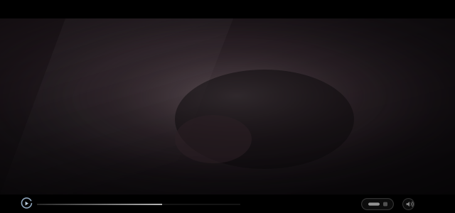

# dsh-bootvideo

A DeepSeek Harness (DSH) plugin bundle that plays a ten-second, full-screen cinematic
boot animation over the DSH Web GUI when the page loads, then fades out and hands the
screen to the workspace. The clip, its poster frames and the pre-JS curtain ship inside
the package and are served by a Host route on the same listener, so playback makes no
network requests.

Version 1.2.0 · [Repository](https://github.com/StellatoL/dsh-bootvideo) · [简体中文](README.zh-CN.md) · MIT for the
code, not for the video (see [Licence](#licence)).



## What it does

On every page load the app shell is covered before it can paint, the clip plays full
screen, and the overlay gets out of the way at the end:

```text
page load  ->  curtain: blurred still + brand line + sweeping bar   (inline, pre-module)
           ->  overlay: sharp poster -> video crossfade
           ->  chrome: letterbox bars, grain, vignette, brand, live progress, sound, skip
           ->  hand-off: bars retract, overlay blurs and fades out (~0.66 s) -> workspace
```

- **Skip:** click anywhere on the overlay or press `Esc`.
- **Sound:** starts muted because browsers block autoplay with sound; the speaker button
  unmutes it. If muted autoplay is refused too, the sequence ends instead of trapping
  the page.
- **Reduced motion:** `prefers-reduced-motion: reduce` gets the still frame for 1.4 s
  instead of the video; if the first frame never paints, a 7 s timer ends the sequence.
- **Frequency:** in `always` mode it runs once per page load, and in-app navigation does
  not replay it. On-screen strings ship in eight languages (en, zh, ja, de, es, fr, pt,
  ru).

## Install

This is a plugin bundle (a package plus a Loader patch), installed from a local
directory:

1. Clone the repository: `git clone https://github.com/StellatoL/dsh-bootvideo.git`
2. In DSH, open **Plugins**, choose **Add plugin**, and select that directory. A local
   directory install links the checkout rather than copying it, so `git pull` updates
   the installed bundle.
3. Reload the DSH Web GUI page. The animation plays on that reload.

The Host half needs a Web carrier with `ctx.webServer` — `dsh web` and the DSH Web GUI
qualify. On shells that load the frontend over `file://` it stays inactive and nothing
plays.

## Settings

All settings are optional keys in the `config` of the single Loader row (`id:
dsh-bootvideo`) that the bundle's own patch inserts. The bundle supplies these
defaults:

| key | default | meaning |
| --- | --- | --- |
| `enabled` | `true` | master switch |
| `playMode` | `always` | `always`, or `oncePerSession` (once per browser session, tracked with the `dsh-bootvideo:booted` key in `sessionStorage`) |
| `startMuted` | `true` | start silent; the unmute button is still offered |
| `skippable` | `true` | allow click and `Esc` to end the sequence early |
| `curtain` | `true` | inject the pre-JS curtain into `index.html` |

To change a value without editing the package, add the row to your profile patch — the
profile's `cordis.patch.yml`, which is applied after the bundle layers. A row with an
existing id targets that row, and its `config` is replaced wholesale, never deep-merged,
so restate every key you want to keep:

```yaml
# <profile dir>/cordis.patch.yml
- id: dsh-bootvideo
  name: dsh-bootvideo
  config:
    enabled: true
    playMode: oncePerSession
    startMuted: true
    skippable: true
    curtain: true
```

The Plugins page reports the row and can enable or disable it; the values live in the
profile patch. Settings are read when the page's startup inputs are produced, so reload
the page after changing them — and in the Desktop app, restart the app, because it reads
its startup inputs once at launch.

## How it works

Two halves, one package, no shared runtime beyond the DOM and one injected settings
global.

Both carriers are supported: a browser page that the Web server renders, and the
Desktop app, whose window loads the shell from its own `dsh-app://app/` origin and
applies Host startup inputs itself. The bundle therefore hooks the carrier-independent
`webserver/index-inject` table rather than the Web-only `tapIndex` transform, and the
Client half can fall back to a settings route when no rows were applied.

### Host half — `index.js`

One Loader row inserted by `cordis.patch.yml` (`id: dsh-bootvideo`). The module declares
`inject = ['webServer']`, so it only activates on a Web carrier that has
`ctx.webServer`; everywhere else it stays inactive.

1. **Media route.** `GET|HEAD /dsh-bootvideo/media/` serves exactly five files:
   `boot.mp4`, `boot.webm`, `poster.jpg`, `poster.webp`, `curtain.jpg`. It supports
   `Range` (206 plus `Content-Range`), `HEAD`, `ETag` + `If-None-Match` (304), answers
   416 for an unsatisfiable range, 405 for other methods, and 404 for anything outside
   the allow-list. Each file is cached in memory and re-read only when its size or
   modification time changes.
2. **Settings route.** `GET /dsh-bootvideo/config` returns the resolved settings as JSON.
   The Client half reads the injected global first and asks this route only when no rows
   were applied, so the sequence still runs on a carrier that drops them.
3. **Index rows.** It appends rows to the `webserver/index-inject` table: a
   `global __DSH_BOOTVIDEO__` settings row and, when the curtain is enabled, a `style`
   row (inline CSS with the blurred frame as a data URL), a body `html` row (the curtain
   markup) and a head `script` row (its behaviour). A Web response renders those rows
   into `index.html`; the Desktop shell applies the same table to its own document. The
   curtain paints before any client module, so the app shell never flashes. It hides
   itself when the client entry is missing from `window.__DSH_BOOT__`, when the plugin
   is disabled, or when the session already saw the animation in `oncePerSession` mode;
   otherwise it lifts on the overlay's ready event, with a 4 s fallback.

### Client half — `client.js`

The manifest's `dsh.client` field (`platform: web`, `immediately: true`) tells the Web
carrier to load `client.js`. It registers into `shell.overlay`, the frame-wide,
click-through layer, and the overlay opts back into pointer events while it owns the
screen.

- The sequence runs from blurred curtain to sharp poster, video crossfade, letterbox
  bars, film grain, vignette, brand line, live progress line, sound toggle and skip
  pill; on end or skip the bars retract and the whole overlay blurs and fades out over
  about 0.66 s.
- On the Desktop origin the clip is fetched once and played from a blob URL, because
  media requests there are relayed through the shell bridge; everywhere else the
  `<video>` streams the files directly with range requests.
- It renders its own `<style>` inside its React tree, so unmounting removes every
  effect with it.
- Autoplay refusal, decode errors and reduced motion are handled in place; the 7 s
  safety timer is the last line of defence, so a media request that never delivers a
  first frame cannot lock the UI.
- It exports no `Config` schema on purpose: with no schema the bundle resolves from any
  profile without pulling in a schema library, and the Host reads settings defensively
  from the Loader row's `config`. The package has zero runtime dependencies.

### Repo layout

| path | contents |
| --- | --- |
| `index.js` | Host half: media route and curtain injection |
| `client.js` | Client half: the overlay |
| `cordis.patch.yml` | bundle patch with the default `config` |
| `package.json` | manifest (`dsh.bundle`, `dsh.client`) |
| `locale/` | plugin metadata in en, zh, ja, de, es, fr, pt, ru |
| `icon.svg` | plugin icon |
| `docs/` | `DETAIL.md`, `DETAIL.zh.md`, `preview.svg`, `preview.zh.svg`, `media.json` |
| `media/` | the five assets plus `README.md` (trim, rights, regeneration) |
| `scripts/build-media.mjs` | the media encoder |
| `scripts/selftest.mjs` | drives the Host half and the injected bundle with no DSH process (`node scripts/selftest.mjs`, 87 checks) |
| `test/fixtures/index.html` | exact copy of the shipped Web shell document the injection is tested against |
| `README.md` | this file; `README.zh-CN.md` is its Chinese translation |
| `LICENSE` | MIT for the code; `CHANGELOG.md` records released changes |

## Media pipeline

The clip is a ten-second trim of the maintainer's own source footage, source time
20.000 s to 30.000 s — frames 480–719 of a 24 fps clip, so the cut is frame aligned.
The poster frame is taken at source t = 20.5 s. Measured payload, all tracked media:

| file | bytes | detail |
| --- | ---: | --- |
| `media/boot.webm` | 986,367 | VP9 1280×720 24 fps 240 frames, Opus 96 kbps stereo — preferred source |
| `media/boot.mp4` | 1,253,025 | H.264 Main 1280×720 24 fps 240 frames, AAC 128 kbps stereo — fallback |
| `media/poster.webp` | 35,740 | frame at source t = 20.5 s |
| `media/poster.jpg` | 61,629 | the same frame, `<video poster>` fallback |
| `media/curtain.jpg` | 350 | 48 px wide blurred frame, inlined as base64 in the curtain |

2,337,111 bytes in total (about 2.3 MB). `docs/media.json` records the size, SHA-256,
codec, frame count and pixels of every file; regenerate it whenever the media changes.

```sh
# full re-encode: needs ffmpeg with libvpx-vp9, libopenh264, libopus, libwebp
SRC=/path/to/source.mp4 node scripts/build-media.mjs

# rewrite docs/media.json only, from the files already on disk
SKIP_ENCODE=1 node scripts/build-media.mjs
```

`FFMPEG` and `FFPROBE` override the binaries; the encoder settings live in
`scripts/build-media.mjs`. `media/README.md` carries the trim details and the rights
note.

## Limitations

- Needs a Web carrier with `ctx.webServer` — `dsh web` and the DSH Web GUI. On shells
  that load the frontend over `file://` the Host half stays inactive and nothing plays.
- The media route is a plain public route on the same listener: it does not require the
  GUI's auth cookie. The listener is loopback by default, so in the default
  configuration this is local-only.
- The clip is fixed at ten seconds; there is no per-user media upload or editor.
- In `always` mode the animation runs once per page load. It does not replay on in-app
  navigation.
- Browsers block autoplay with sound, so the sequence starts muted and offers a sound
  toggle.
- The video assets are the maintainer's footage, not MIT-licensed; redistributors must
  hold the rights to them and may replace the files in `media/` (keeping the names).
- The brand line, progress line and controls are part of the overlay; the media and the
  five settings are the configurable surface.

## Licence

The code is MIT-licensed; see [LICENSE](LICENSE). The footage in `media/` is the
maintainer's own material and is **not** covered by that licence: anyone redistributing
this bundle is responsible for holding the rights to the clip, and can replace the five
files in `media/` (keeping their names) to ship their own footage. `media/README.md`
spells this out.
