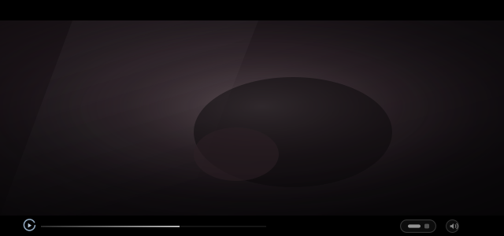

# dsh-openvideo

一个 DeepSeek Harness（DSH）插件包（bundle）：页面加载时在 DSH Web GUI 上播放一段十秒的全屏电影感启动动画，随后淡出，把屏幕交还给工作区。片段、静帧海报（poster）和 JS 执行前的幕布（curtain）都随包发布，并由同一监听端口上的 Host 路由提供，因此播放过程不发起任何网络请求。

版本 1.0.0 · [代码仓库](https://github.com/StellatoL/dsh-openvideo) · [English](README.md)
代码采用 MIT，视频素材不适用（见[许可](#许可)）。



## 功能概览

每次页面加载，应用外壳都会在绘制之前被盖住，片段全屏播放，结束时覆盖层让出屏幕：

```text
页面加载  ->  幕布 curtain：模糊静帧 + 品牌行 + 扫光进度条   （内联，早于任何模块）
          ->  覆盖层 overlay：清晰静帧 -> 视频交叉淡入
          ->  界面元素 chrome：上下遮幅、颗粒、暗角、品牌、实时进度、声音、跳过
          ->  交接 hand-off：遮幅收起，覆盖层模糊淡出（约 0.66 s）-> 工作区
```

- **跳过：** 点击覆盖层任意位置，或按 `Esc`。
- **声音：** 默认静音，因为浏览器会拦截带声音的自动播放；点击扬声器按钮即可取消静音。如果连静音自动播放也被拒绝，序列会直接结束，而不是把页面卡住。
- **减少动态效果：** 当 `prefers-reduced-motion: reduce` 生效时，用 1.4 s 的静帧代替视频；如果首帧始终没有绘制出来，7 s 计时器会结束序列。
- **播放频率：** `always` 模式下每次页面加载播放一次，应用内导航不会重播。屏幕文案内置八种语言（en、zh、ja、de、es、fr、pt、ru）。

## 安装

这是一个插件包（bundle），由一个包体加一份 Loader 补丁（patch）组成，从本地目录安装：

1. 克隆仓库：`git clone https://github.com/StellatoL/dsh-openvideo.git`
2. 在 DSH 中打开 **Plugins**，选择 **Add plugin**，选中该目录。本地目录安装会以链接方式指向 checkout，而不是复制，因此 `git pull` 就能更新已安装的 bundle。
3. 重新加载 DSH Web GUI 页面，动画会在这次加载时播放。

Host 端需要一台提供 `ctx.webServer` 的 Web 载体（carrier）——`dsh web` 和 DSH Web GUI 都满足；在用 `file://` 加载前端的 shell 中它保持不激活，什么都不会播放。

## 设置

所有设置都是可选的，位于 bundle 自带补丁插入的那行 Loader 行（Loader row，`id` 为 `dsh-openvideo`）的 `config` 中。bundle 提供的默认值如下：

| 键 | 默认值 | 含义 |
| --- | --- | --- |
| `enabled` | `true` | 总开关 |
| `playMode` | `always` | `always`，或 `oncePerSession`（每个浏览器会话一次，用 `sessionStorage` 中的 `dsh-openvideo:booted` 键记录） |
| `startMuted` | `true` | 以静音开始；仍然提供取消静音按钮 |
| `skippable` | `true` | 允许点击或 `Esc` 提前结束 |
| `curtain` | `true` | 把 JS 执行前的幕布注入 `index.html` |

如果不想改包内文件，可以把这一行加到你的 profile 补丁（profile patch）里——也就是 profile 的 `cordis.patch.yml`，它在 bundle 层之后应用。带已有 id 的行会命中同一行，其 `config` 会被整体替换、不做深合并，所以要把想保留的键全部重新写出来：

```yaml
# <profile dir>/cordis.patch.yml
- id: dsh-openvideo
  name: dsh-openvideo
  config:
    enabled: true
    playMode: oncePerSession
    startMuted: true
    skippable: true
    curtain: true
```

Plugins 页面会显示这一行，也能启用或禁用它；具体取值保存在 profile 补丁里。设置会被编译进服务端返回的 `index.html`，所以修改后需要重新加载页面。

## 实现方式

两个半边、一个包，除 DOM 和一个注入的设置全局变量外没有共享运行时。

### Host 端 —— `index.js`

`cordis.patch.yml` 插入的一行 Loader 行（Loader row，`id: dsh-openvideo`）。模块声明 `inject = ['webServer']`，因此只在拥有 `ctx.webServer` 的 Web 载体（carrier）上激活；其他环境保持不激活。

1. **媒体路由（route）。** `GET|HEAD /dsh-openvideo/media/` 只提供五个文件：`boot.mp4`、`boot.webm`、`poster.jpg`、`poster.webp`、`curtain.jpg`。它支持 `Range`（206 加 `Content-Range`）、`HEAD`、`ETag` + `If-None-Match`（304），对无法满足的 range 返回 416，对其他方法返回 405，对允许列表之外的一切返回 404。每个文件在内存中缓存，只有大小或修改时间变化时才重新读取。
2. **index.html 注入。** 通过 `ctx.webServer.tapIndex(...)` 向 `index.html` 写入设置全局变量 `window.__DSH_OPENVIDEO__`；幕布开启时，还会写入内联 CSS、一段同步内联脚本，以及作为 `<body>` 第一个子节点的一个 `<div>`（含其子节点）。这些内容早于任何客户端模块执行，因此应用外壳不会闪现。当插件在 `window.__DSH_BOOT__` 中缺少客户端条目、插件被禁用，或 `oncePerSession` 模式下本次会话已经播放过时，幕布会自行移除；否则它在覆盖层发出就绪事件时收起，并有 4 s 兜底。

### 客户端 —— `client.js`

manifest 的 `dsh.client` 字段（`platform: web`、`immediately: true`）告诉 Web 载体加载 `client.js`。它注册到 `shell.overlay` 插槽（slot）——横跨整个窗口、本身点击穿透的图层；覆盖层（overlay）在占据屏幕期间重新接管指针事件。

- 序列从模糊幕布开始，依次是清晰静帧、视频交叉淡入、上下遮幅（letterbox bars）、胶片颗粒（film grain）、暗角（vignette）、品牌行、实时进度线、声音开关和跳过按钮（skip）；播放结束或跳过时，遮幅收起，整个覆盖层模糊并在约 0.66 s 内淡出。
- 它把 `<style>` 渲染在自己的 React 树内，卸载时所有效果一并移除。
- 自动播放被拒绝、解码失败和减少动态效果都在原地处理；7 s 安全计时器是最后一道防线，因此始终拿不到首帧的媒体请求不会锁死界面。
- 它有意不导出 `Config` schema：没有 schema，bundle 可以在任何 profile 中解析，而不必引入 schema 库；Host 改为防御性地从 Loader 行的 `config` 读取设置。本包没有运行时依赖。

### 仓库结构

| 路径 | 内容 |
| --- | --- |
| `index.js` | Host 端：媒体路由和幕布注入 |
| `client.js` | 客户端：覆盖层 |
| `cordis.patch.yml` | bundle 补丁，含默认 `config` |
| `package.json` | manifest（`dsh.bundle`、`dsh.client`） |
| `locale/` | 插件元数据，en、zh、ja、de、es、fr、pt、ru |
| `icon.svg` | 插件图标 |
| `docs/` | `DETAIL.md`、`DETAIL.zh.md`、`preview.svg`、`preview.zh.svg`、`media.json` |
| `media/` | 五个媒体文件，以及 `README.md`（截取、版权、重新生成） |
| `scripts/build-media.mjs` | 媒体编码脚本 |
| `scripts/selftest.mjs` | 不需要 DSH 进程即可驱动 Host 端与注入脚本的自检（`node scripts/selftest.mjs`，73 项检查） |
| `README.md` | 本文件；`README.zh-CN.md` 是它的中文翻译 |
| `LICENSE` | 代码采用 MIT；`CHANGELOG.md` 记录已发布的变更 |

## 媒体管线

这段视频截取自维护者自己的源素材，源时间 20.000 s 到 30.000 s —— 24 fps 素材的第 480–719 帧，因此切点是帧对齐的。静帧海报取自源时间 t = 20.5 s。所有受跟踪媒体文件的实测负载：

| 文件 | 字节数 | 细节 |
| --- | ---: | --- |
| `media/boot.webm` | 986,367 | VP9 1280×720 24 fps 240 帧，Opus 96 kbps 立体声 —— 首选源 |
| `media/boot.mp4` | 1,253,025 | H.264 Main 1280×720 24 fps 240 帧，AAC 128 kbps 立体声 —— 回退源 |
| `media/poster.webp` | 35,740 | 源时间 t = 20.5 s 处的帧 |
| `media/poster.jpg` | 61,629 | 同一帧，供 `<video poster>` 回退 |
| `media/curtain.jpg` | 350 | 48 px 宽的模糊帧，以 base64 内联进幕布 |

合计 2,337,111 字节（约 2.3 MB）。`docs/media.json` 记录每个文件的大小、SHA-256、编码、帧数和像素尺寸；媒体变化后重新生成它。

```sh
# 完整重新编码：需要带 libvpx-vp9、libopenh264、libopus、libwebp 的 ffmpeg
SRC=/path/to/source.mp4 node scripts/build-media.mjs

# 只根据磁盘上已有的文件重写 docs/media.json
SKIP_ENCODE=1 node scripts/build-media.mjs
```

`FFMPEG` 和 `FFPROBE` 可覆盖二进制路径；编码参数在 `scripts/build-media.mjs` 里。`media/README.md` 记录了截取细节和版权说明。

## 限制

- 需要提供 `ctx.webServer` 的 Web 载体（carrier）——`dsh web` 和 DSH Web GUI。在用 `file://` 加载前端的 shell 中，Host 端保持不激活，什么都不会播放。
- 媒体路由是同一监听端口上的普通公开路由：它不要求 GUI 的鉴权 cookie。该监听默认只绑定回环地址，因此在默认配置下仅限本机访问。
- 片段固定为十秒；没有按用户上传媒体或编辑媒体的功能。
- `always` 模式下动画每次页面加载播放一次。应用内导航不会重播。
- 浏览器会拦截带声音的自动播放，因此序列以静音开始，并提供声音开关。
- 视频素材是维护者拍摄的素材，不适用 MIT 许可；再分发者必须自己持有其权利，也可以替换 `media/` 中的文件（保持文件名不变）。
- 品牌行、进度线和控件都是覆盖层的一部分；可配置范围只有媒体文件和这五项设置。

## 许可

代码采用 MIT 许可，见 [LICENSE](LICENSE)。`media/` 中的素材归维护者所有，**不**在本许可覆盖范围内：任何再分发本 bundle 的人都有责任持有该片段的权利，也可以替换 `media/` 中的五个文件（保持文件名不变）来发布自己的素材。`media/README.md` 对此有说明。
